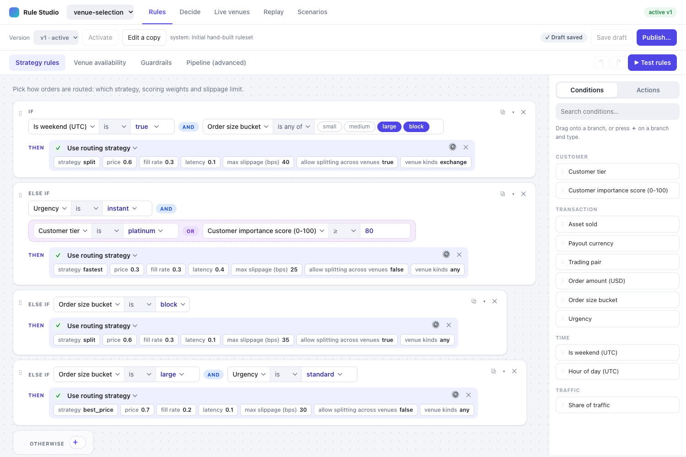
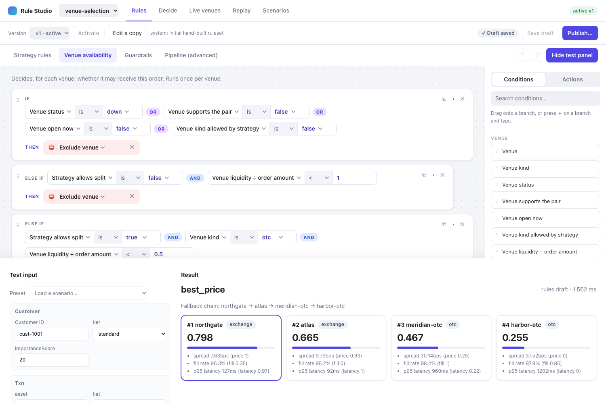
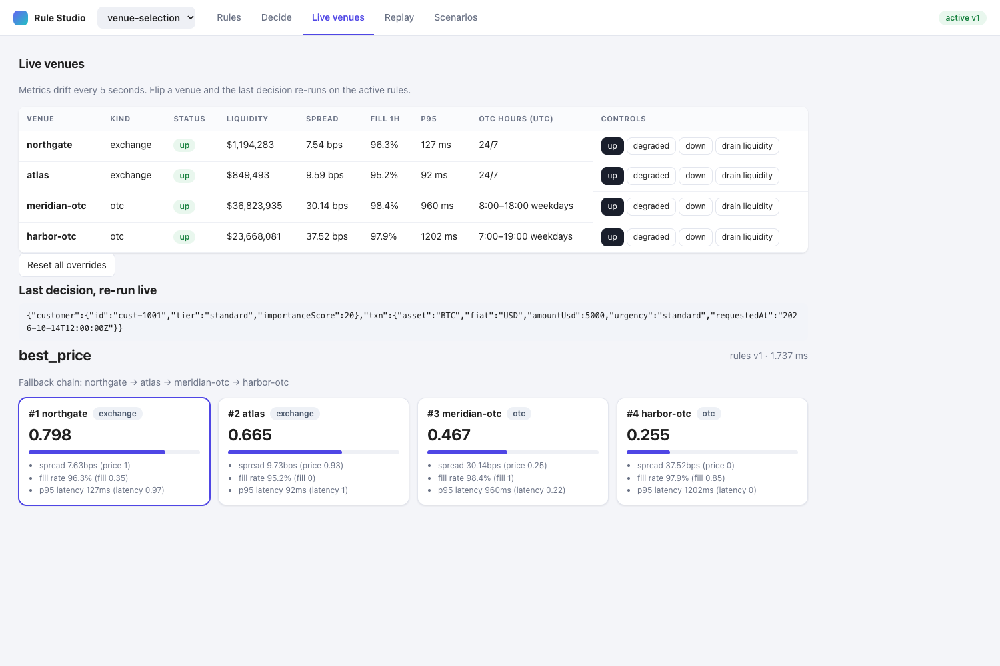
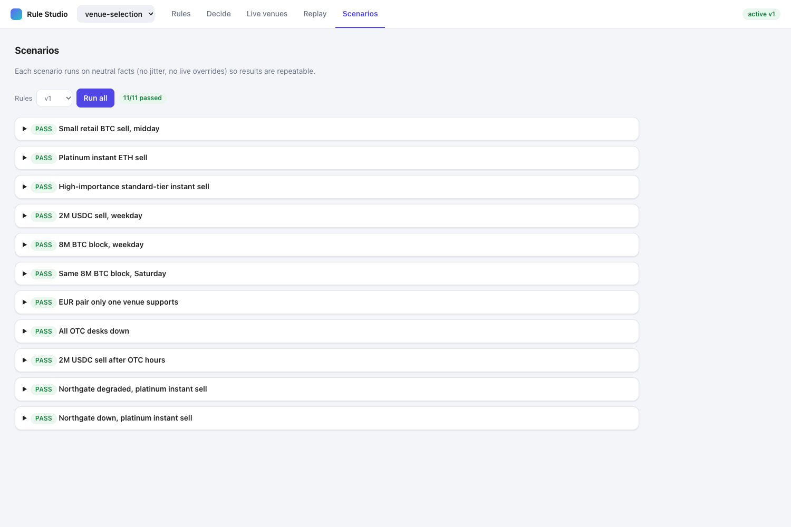
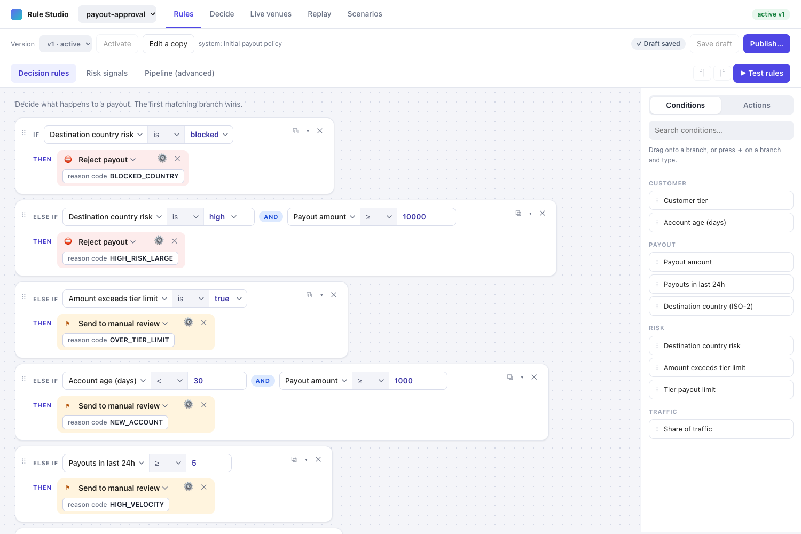

# Venue Router Demo

A visual rules studio built on [GoRules ZEN](https://gorules.io). You build decision rules by dragging conditions and actions onto a tree, test them against live data, version them, and replay a thousand inputs before you ship a change. Nobody on the rules side writes an expression or a script.

The demo ships with two domains. The first picks a trading venue for a crypto-to-fiat sell. The second approves, reviews or rejects payouts. They run on the same engine and the same UI. The second one exists to prove that point: adding it took a new folder and no code changes.

**Try it in your browser: https://czemelman.github.io/venue-router-demo/** (no install, no server)



## What it does

You edit rules as a tree. Each rule reads like a sentence: `IF urgency is instant AND (customer tier is platinum OR importance is at least 80) THEN use the fastest strategy`. Conditions can be grouped with AND and OR, nested as deep as you need, and dragged between branches. Undo, redo, copy and paste all work.

The server compiles each tree into GoRules expression nodes and runs it on the ZEN engine. In the normal setup the browser never evaluates a rule: when you press Test, the request goes to the server, and the branch that matched lights up in the editor. The hosted demo has no server, so it runs the same engine inside your tab instead (see Live demo below).



Other things worth knowing about:

- Drafts and versions. You edit a draft, publish it as an immutable version, and activate or roll back with one click.
- Live facts. Venue status, spreads and latency come from a facts provider that the domain defines. You can override a venue to "down" on the Live page and watch decisions change.
- Scenarios. Each domain has named test cases with expected outputs. They run against neutral facts, so results are repeatable.
- Replay. Run a thousand generated inputs (the default) through two versions and compare how the decisions are distributed.
- A stable traffic split. "Is in the first 10% of traffic" hashes a key you choose, so the same customer always lands in the same bucket.





## Live demo

The hosted demo has no backend. It runs the WebAssembly build of ZEN 2.1.7, the same engine version the server uses, inside your browser tab. A small stand-in for the API (`apps/web/src/demo/backend.ts`) answers the same routes the server does, so the UI is identical in both modes.

Everything works: editing rules, testing, publishing, rolling back, scenarios, replay, live venue overrides, and both domains. Your edits and published versions are saved in your browser's local storage, so nobody else sees them. The Reset button next to "Live demo" in the header restores the original rules.

A few differences from the server setup:

- The first visit downloads about 15 MB, which is the engine. After that the browser caches it.
- Replay is capped at 1000 inputs, since the engine shares your tab.
- There is no decision log file. The Decide page keeps the last 500 decisions in memory only.

A test runs all 18 scenarios through both the native engine and the WebAssembly one and requires identical output. To build the demo yourself, run `pnpm --filter @venue/web build:demo`. A GitHub Actions workflow publishes it to Pages on every push to `main`.

## Quick start

You need Node 20 or newer and [pnpm](https://pnpm.io/installation).

```sh
git clone https://github.com/czemelman/venue-router-demo.git
cd venue-router-demo
pnpm install
pnpm dev
```

Open http://localhost:5173. The API runs on port 3101, and the web app proxies `/api` to it. To use a different API port, set `PORT` for the server and update the proxy in `apps/web/vite.config.ts`.

Other commands:

```sh
pnpm test        # server and web unit tests
pnpm typecheck   # TypeScript, both apps
pnpm build       # production build of the web app (talks to the server)
pnpm --filter @venue/web build:demo   # static build with the engine in the browser
pnpm recompile   # rebuild generated expression nodes from the rule trees
```

## A short tour

1. Open Rules and pick Strategy rules. Change a condition, or drag one in from the right sidebar.
2. Press Test rules, load a scenario, and run it. The matched branch gets a green outline.
3. Press Save draft, then Publish. Give the version a short note.
4. Switch to Scenarios and press Run all. All eleven should pass.
5. Open Live venues, mark northgate as down, and run the same test again. The ranking changes and the fallback chain skips it.
6. Use the domain picker in the header to switch to payout-approval. Same screens, different rules.



## How it works

```
 browser (React, jdm-editor)         server (Fastify)                     ZEN engine
 ┌──────────────────────┐   HTTP   ┌─────────────────────────┐          ┌────────────┐
 │ rule tree editor     │ ───────▶ │ validate + compile tree │ ───────▶ │ decisions  │
 │ test panel, replay   │ ◀─────── │ facts, versions, replay │ ◀─────── │ (per file) │
 └──────────────────────┘          └─────────────────────────┘          └────────────┘
```

A domain's decision graph is a JDM file with an input node, some expression and function nodes, and an output node. The rule trees you edit live in the same file under a `policy` key and are the source of truth. On every save the server turns each tree into nested ternaries inside a generated expression node. If a tree has an empty group or points at an unknown field, the save is rejected with a message instead of producing a broken rule.

The compiler never builds a string literal by hand-escaping. ZEN strings have no escape sequences, so it picks a delimiter that the value does not contain. A test covers quotes, backslashes and an attempted injection.

Each rule set has a mode. In "first" mode the tree is evaluated top to bottom and the first match wins. In "all" mode every rule card is independent and the results are merged. A set can also run once per item, which is how venue availability works.

The engine rules the server follows:

- One `ZenEngine` per process, and `dispose()` on shutdown.
- Decisions are cached per domain and version. A draft is cached by content hash.
- Tracing is switched on only for simulate and replay, since it is slower.

## Repository layout

```
apps/
  server/            Fastify API, versioning, decision log
  web/               React app, rule tree editor, and the in-browser backend for the demo
packages/
  shared/            Types, rule compiler, scenario and replay logic used by both
domains/
  venue-selection/   Domain 1: pick a trading venue
  payout-approval/   Domain 2: approve, review or reject a payout
docs/
  images/            Screenshots used in this README
```

## Adding your own domain

Create a folder under `domains/`. The server finds it on startup.

```
domains/my-domain/
  domain.json        schemas, the rule catalog, optional bucketBy key
  facts.ts           the facts provider (live data, overrides, input generator)
  scenarios.json     named test cases with expected outputs
  rules/
    draft.json       the decision graph and its policy
```

The catalog in `domain.json` is where a developer writes the ZEN snippets once. It lists three things:

- fields, the things a rule can test, each with a type and a `expr` snippet that reads it from the input or the facts
- actions, what a rule can do, with typed parameters and the output keys it sets
- sets, which fields and actions belong to each rule set, plus the mode and the default

After that, rule authors only see labels and dropdowns. `domains/payout-approval` is the smallest complete example to copy from.

## API

All routes are scoped to a domain, for example `/domains/venue-selection/decide`.

| Method | Path | Purpose |
| --- | --- | --- |
| GET | `/domains` | List domains |
| GET | `/domains/:d` | Metadata, scenarios, active version |
| GET, PUT | `/domains/:d/rules/draft` | Read or save the draft |
| POST | `/domains/:d/rules/publish` | Freeze the draft as a new version |
| POST | `/domains/:d/rules/activate/:v` | Make a version live |
| POST | `/domains/:d/decide` | Run the active version |
| POST | `/domains/:d/simulate` | Run any version with a trace |
| POST | `/domains/:d/replay` | Compare two versions over many inputs |
| POST | `/domains/:d/scenarios/run` | Run the scenario file |
| GET, POST | `/domains/:d/facts`, `/facts/override` | Read or override live facts |

## Tests

The server suite checks the JDM schema, all eleven venue scenarios through the real HTTP layer, the compiler for every operator, publish and rollback, replay, and parity between the native and WebAssembly engines. It works on a temporary copy of `domains/`, so running it never touches your rules. The web suite covers the tree operations: drop, move, wrap, paste and validation.

Not covered by automated tests: drag-and-drop in a real browser. That part was checked by hand.

## Limits

This is a demo, and a few things are left out on purpose.

- There is no fail-over action. The engine ranks venues up front and returns a fallback list, but nothing downstream retries on a soft decline.
- Rule trees are per rule set. There are no shared profiles that one tree can reuse across connectors.
- Risk metrics over a time window, such as chargebacks in the last 30 days, need history that the demo does not keep.
- Authentication, multi-user editing and a database are not included. Versions and drafts are plain files, or browser storage in the hosted demo.

## Built with

[GoRules ZEN](https://github.com/gorules/zen) and [@gorules/jdm-editor](https://github.com/gorules/jdm-editor), Fastify, React, Vite, Zod, Ajv and Vitest.

## License

MIT. See [LICENSE](LICENSE).
